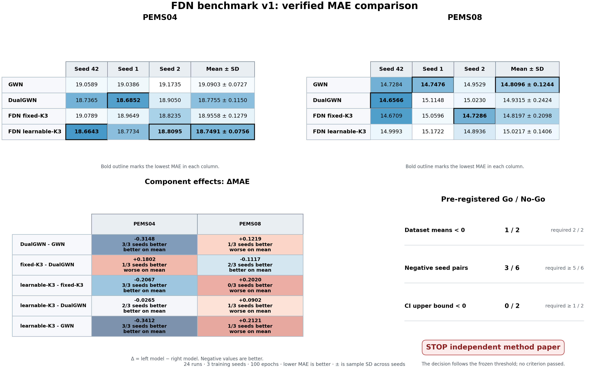
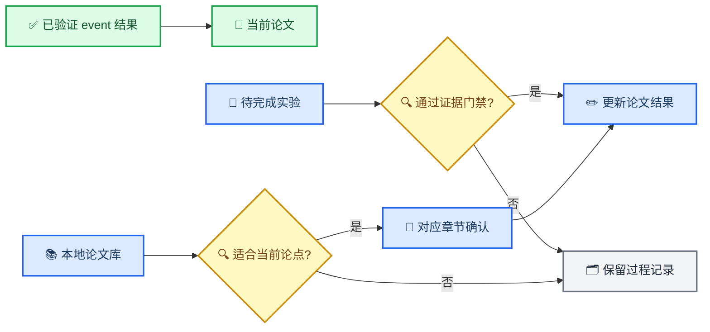

# FDN EI 论文进度与实验清单

_当前论文、实验待办与本地文献审计，更新于 2026-08-25_

---

## 📋 TL;DR

- **论文状态：** Overleaf 最新提交为 `1f6491f`，Evaluation 已加入不含 NDR-Net 的 14 模型完整结果表
- **当前证据：** 论文使用 v3 无泄露 event 表中的 14 种方法，FDN 在三个地区均优于单分支 GWN
- **消融结果：** FDN benchmark v1 已完成 24/24、0 failed；预注册决策为 `stop_independent_method_paper`，结果暂不写入论文正文
- **文献状态：** 本地 11 份 PDF 已完成初筛，6 份建议加入 Related Work，1 份可选，3 份已引用，1 份不建议纳入
- **远端状态：** full-window 42 项目前为 14 项完成、3 项失败、3 项中断、22 项未启动，不能写成正在运行或完整结果
- **训练授权：** 本次 24 项 FDN benchmark 已完成；租用 GPU、恢复其他远端队列或扩大矩阵仍需用户明确授权

---

## 🚀 FDN benchmark v1 启动记录

2026-08-25，用户已明确授权开始消融实验。正式矩阵保持原预注册设计，不修改模型、数据集、种子、训练预算或停止线。

| 启动门禁 | 状态 | 证据 |
| --- | --- | --- |
| 正式代码身份 | 通过 | 四卡启动代码固定为 `e2bb236bcbb67ad0b39c0330172c00ad8b20118b` |
| 四卡分片 | 通过 | 24 项按 canonical 顺序分为四个互斥 shard，每个 shard 6 项，完整并集为 24 项 |
| 专项回归 | 通过 | FDN benchmark、runner、5080 与 Linux 四卡启动及恢复测试合计 14 passed |
| 全仓回归 | 通过 | 672 passed，2 个既有 warning |
| 数据身份 | 通过 | PEMS04、PEMS08 数据和邻接文件 SHA-256 与 canonical manifest 完全一致 |
| 本地优化步探针 | 通过 | PEMS04、PEMS08 乘四种变体，共 8/8 个 MPS 单优化步探针通过 |
| 等容量关系 | 通过 | DualGWN 与 fixed-K3 参数量相同，learnable-K3 只增加 7 个频率 mask 参数 |
| 正式 CUDA 主机 | 通过 | 4×RTX 5090，每卡 32,607 MiB；Python 3.12.3、PyTorch 2.12.1+cu130，CUDA runtime 可用 |
| 远端 CUDA 探针 | 通过 | PEMS04、PEMS08 乘四种变体，共 8/8 个真实 CUDA 优化步探针通过 |
| 正式训练进度 | 通过 | 24/24 completed，0 failed；四个 shard 均为 6/6，聚合 queue 状态为 completed |
| 正式结果复验 | 通过 | 修复后的控制代码重新验证 24 个 summary、prediction、forecast origin、100 条 epoch 记录和必需 artifact |
| 结果回传 | 通过 | 223/223 文件完成 Mac 逐文件大小与 SHA-256 复验，总计 1,077,481,495 bytes |
| 报告复现 | 通过 | Mac 独立重跑 Go/No-Go 报告，与远端 6 个报告文件逐字节一致 |

本地 MPS 探针只验证数据加载、前向、反向和优化步，不作为正式消融结果。正式矩阵使用训练代码 SHA `e2bb236bcbb67ad0b39c0330172c00ad8b20118b` 和 manifest SHA-256 `2a1a999f67492d39e00309cda52737dc6e79bb14d3df3e672a28f183d4216ac6`。Linux 四卡 launcher 使用 fail-closed 分片、独立日志与状态、原子任务提升及 24/24 聚合完成门。正式结果已经完成，暂不进入论文正文。

首次四项训练均完成 100 epochs 并形成完整 artifact，但 runner 的单 horizon 复算错误地使用二维 mask 索引三维误差张量，把全部 12 个 horizon 的误差累计到 H3、H6 与 H12，因而在正式发布前 fail-closed。该问题不影响训练器 summary、checkpoint 或 prediction artifact。控制修复提交为 `f444235a6c98ed51e09f0dd0b0c3d1607126efec`。修复后的控制代码先对四个真实 attempt 做只读复验，确认 summary 与 prediction 重算一致，再以 `completed_recovered` 原子提升。后续训练继续使用原训练代码 SHA `e2bb236bcbb67ad0b39c0330172c00ad8b20118b`，没有重写或混合训练身份。

---

## ✅ FDN benchmark v1 正式结果

### 完整性与身份

| 对象 | 值 |
| --- | --- |
| 矩阵状态 | `24/24 completed`、`0 failed` |
| 数据集、种子与配置 | PEMS04、PEMS08；seeds 42、1、2；GWN、DualGWN、fixed-K3、learnable-K3 |
| 训练预算 | 100 epochs，不提前停止，按全 validation 有效观测 MAE 选择 checkpoint |
| 训练代码 SHA | `e2bb236bcbb67ad0b39c0330172c00ad8b20118b` |
| 控制修复 SHA | `f444235a6c98ed51e09f0dd0b0c3d1607126efec` |
| Canonical manifest SHA-256 | `2a1a999f67492d39e00309cda52737dc6e79bb14d3df3e672a28f183d4216ac6` |
| 聚合 queue SHA-256 | `bc9455bb46ee418682578e2c35116dc37609cd8c2f822a246fdcda33fe53edc1` |
| 正式报告 SHA-256 | `1d49f6b08a35514ae207f999cc3f94ab2825d4e5a3970a1e70187b093a4e12c1` |
| 传输清单 SHA-256 | `2c4c2663dbffdf28c543ba43f0be26afe57bb5c556c63990f22bef2cb7547726` |
| 回传归档 SHA-256 | `7cead8b107804c78663660ab1c5751e10c71770f7681be4a4e19435da6343721` |
| Mac 文件复验 | 223/223，1,077,481,495 bytes，大小与 SHA-256 全部一致 |
| Mac 报告复现 | 6 个报告文件与远端逐字节一致 |

本地正式入口为 [FDN benchmark v1 formal export](../../outputs/remote_runs/fdn_benchmark_v1_formal_20260825/)。该目录被 Git 忽略，本文记录其不可变身份和关键结论。

### 预注册 Go/No-Go 判定

主要比较为 learnable-K3 减等参数 DualGWN 的 Average MAE。负值表示 learnable-K3 更好。

| 预注册条件 | 要求 | 正式结果 | 判定 |
| --- | ---: | ---: | --- |
| 两个数据集三种子平均差均为负 | 2/2 | 1/2 | 未通过 |
| 六个数据集与种子配对点为负 | 至少 5/6 | 3/6 | 未通过 |
| 层级 bootstrap 的 95% CI 上界低于 0 | 至少 1/2 | 0/2 | 未通过 |

正式决策为 `stop_independent_method_paper`。该停止线按预注册规则执行，不因结果方向修改。

### 三种子 Average MAE

| 数据集 | GWN | DualGWN | fixed-K3 | learnable-K3 |
| --- | ---: | ---: | ---: | ---: |
| PEMS04 | 19.0903 ± 0.0727 | 18.7755 ± 0.1150 | 18.9558 ± 0.1279 | 18.7491 ± 0.0756 |
| PEMS08 | 14.8096 ± 0.1244 | 14.9315 ± 0.2424 | 14.8197 ± 0.2098 | 15.0217 ± 0.1406 |

该图只保留 PEMS04 与 PEMS08 的模型性能表。PNG 为不透明 RGB，3520×1100 pixels，元数据 DPI 为 220；另有同名矢量 PDF。

### 组件配对差

下表左侧模型减右侧模型。负值表示左侧模型的 MAE 更低。

| 数据集 | DualGWN 减 GWN | fixed-K3 减 DualGWN | learnable-K3 减 fixed-K3 | learnable-K3 减 DualGWN | learnable-K3 减 GWN |
| --- | ---: | ---: | ---: | ---: | ---: |
| PEMS04 | -0.3148 | +0.1802 | -0.2067 | -0.0265 | -0.3412 |
| PEMS08 | +0.1219 | -0.1117 | +0.2020 | +0.0902 | +0.2121 |

容量、固定分解和可学习 mask 的方向均依赖数据集。PEMS04 中，双容量对单 GWN 有稳定收益，learnable-K3 又在三个 seed 中全部优于 fixed-K3，但相对 DualGWN 只有 2/3 个 seed 为负。PEMS08 中，learnable-K3 在三个 seed 中全部弱于 fixed-K3，相对 DualGWN 只有 1/3 个 seed 为负。

### learnable-K3 与 DualGWN 的配对证据

| 数据集 | seed 42 | seed 1 | seed 2 | 三种子平均差 | 层级 bootstrap 95% CI |
| --- | ---: | ---: | ---: | ---: | ---: |
| PEMS04 | -0.0722 | +0.0883 | -0.0954 | -0.0265 | [-0.1194, 0.0916] |
| PEMS08 | +0.3427 | +0.0574 | -0.1294 | +0.0902 | [-0.1159, 0.3480] |

两个置信区间均跨越 0。重叠滑窗没有被视为独立重复，层级 bootstrap 先在训练 seed 层重采样，再在每个 seed 内按 288 个 forecast origin 的日块重采样。

### 效率与容量

| 数据集 | 配置 | 参数量 | 三种子平均训练时间，秒 | 峰值显存，MiB |
| --- | --- | ---: | ---: | ---: |
| PEMS04 | GWN | 311,368 | 1,137.5 | 1,532.84 |
| PEMS04 | DualGWN | 622,736 | 1,553.8 | 2,926.35 |
| PEMS04 | fixed-K3 | 622,736 | 1,540.1 | 2,925.90 |
| PEMS04 | learnable-K3 | 622,743 | 1,577.8 | 2,926.69 |
| PEMS08 | GWN | 308,628 | 1,138.3 | 878.34 |
| PEMS08 | DualGWN | 617,256 | 1,559.1 | 1,651.11 |
| PEMS08 | fixed-K3 | 617,256 | 1,539.2 | 1,654.02 |
| PEMS08 | learnable-K3 | 617,263 | 1,565.1 | 1,654.45 |

DualGWN 与 fixed-K3 参数量完全相同。learnable-K3 只增加 7 个 mask 参数。相对单 GWN，三种双分支配置的峰值显存约为 1.88 至 1.91 倍。

### 学习后的七频点 mask

| 数据集 | bin 0 | bin 1 | bin 2 | bin 3 | bin 4 | bin 5 | bin 6 |
| --- | ---: | ---: | ---: | ---: | ---: | ---: | ---: |
| PEMS04 | 0.8613 ± 0.0055 | 0.9063 ± 0.0108 | 0.7724 ± 0.0280 | 0.2765 ± 0.0445 | 0.2117 ± 0.0219 | 0.2101 ± 0.0156 | 0.2052 ± 0.0231 |
| PEMS08 | 0.8607 ± 0.0030 | 0.9085 ± 0.0010 | 0.8069 ± 0.0140 | 0.2550 ± 0.0245 | 0.1875 ± 0.0243 | 0.1546 ± 0.0140 | 0.1388 ± 0.0109 |

学习后的 mask 在两个数据集上都保留了前三个频点的较高 Main 权重，并给后四个频点较低权重。该结构一致性不能替代性能证据，因为 learnable-K3 的相对性能方向在两个数据集上不一致。

### 论文处理边界

1. 当前结果不支持“可学习频率路由稳定优于等容量双分支”的强机制主张。
2. 不启动 PEMS03 与 PEMS07 扩展，因为第一阶段 Go 门未通过。
3. 当前 XTraffic event 正文只能继续表述完整 FDN 配置相对单分支 GWN 的描述性结果，不能用本消融证明增益来自 Fourier 路由。
4. 若后续决定把本消融写入论文，必须完整报告 PEMS04 的正方向与 PEMS08 的负方向，不选择性省略。
5. 本节保留在进度文档中，尚未修改 Evaluation 或 Conclusion。

---

## 🎯 论文与证据更新流程

---

## ✅ 当前论文快照

| 项目 | 当前内容 | 证据或入口 |
| --- | --- | --- |
| Overleaf 提交 | `1f6491f` | `Add complete XTraffic evaluation table` |
| Evaluation | v3 无泄露 event 协议、14 种方法、H3/H6/H12/Average 的完整 MAE、RMSE、MAPE 表 | [Evaluation](../../overleaf_paper/Sections/4-Evaluation.tex) |
| Conclusion | FDN 方法总结与三地区一致优于 GWN 的结论 | [Conclusion](../../overleaf_paper/Sections/5-Conclusion.tex) |
| 参考文献 | 25 条，包含已补充的分解、频率预测和交通预测论文 | [report.bib](../../overleaf_paper/report.bib) |
| 结果主表 | seed 42、最多 30 epoch、14 种方法的论文子集 | [verified table](../../outputs/protocol_v3_noleak_dedup/event_full45_fdn_20260812/verified_table/table.csv) |
| FDN Average MAE | Alameda 12.129261、Contra Costa 13.282892、Orange 12.562904 | verified table |
| GWN Average MAE | Alameda 12.616974、Contra Costa 13.462997、Orange 12.916876 | verified table |
| 相对改善 | 3.87%、1.34%、2.74% | 由 verified table 计算 |

论文正文只维护已完成、已复验和已经确认的内容。下面的实验计划不进入当前稿件。

---

## 🔍 远端训练只读审计

审计时间为 2026-08-24 10:42，远端以无卡模式启动。数据盘完整保留，当前没有训练、runner 或 CUDA 进程。检查对象为 `protocol_v3_noleak_dedup` 下的 full-window 42 项矩阵。

| 状态 | 数量 | 说明 |
| --- | ---: | --- |
| 正式完成 | 14 | 任务目录、`summary.json` 和 completed state 已落盘 |
| 失败 | 3 | Alameda BiST、Alameda NDR-Net、Contra Costa BiST，均因 run identity model mismatch 失败 |
| 中断 | 3 | Alameda DGCRN、Contra Costa ASTGCN、Contra Costa DSTAGNN，state 仍写 running，但当前没有对应进程 |
| 未启动 | 22 | 主要为 Contra Costa 后续任务和全部 Orange 任务 |
| 合计 | 42 | 尚未形成完整矩阵、postflight、composite 或论文表 |

共享 `queue_status.json` 只反映最后写入的单个 7 项 shard，并显示 3/7。六个 shard 并发共用同一个状态文件，因此该文件不能作为 42 项总体进度。总体状态必须从 42 项 manifest、逐任务 state 和正式任务目录联合重建。

三个中断任务的检查点只包含模型权重、best epoch 和验证指标，不包含 optimizer、scheduler、下一 epoch 游标或随机数状态。它们不能严格续跑，若恢复正式矩阵，需要保留现有 staging incident 并从 epoch 0 新建 attempt。

已落盘的 Alameda full-window FDN 与 GWN Average MAE 分别为 `10.816044` 和 `11.249785`。该方向支持 FDN，但当前只是一组已完成单项，完整矩阵与发布门禁完成前不进入论文。

FDN benchmark v1 已在独立的 4×RTX 5090 实例完成 24/24、0 failed，并完成远端报告、结果回传和 Mac 独立复验。该矩阵与本节审计的 full-window 42 项使用不同任务、数据、代码身份和结果目录，不能混合统计。

---

## 🧪 实验清单

### 最高优先级

| 实验 | 当前状态 | 最小设计 | 完成门 | 完成后的论文动作 |
| --- | --- | --- | --- | --- |
| FDN benchmark v1 | 已完成并复验 | PEMS04、PEMS08；GWN、DualGWN、fixed-K3、learnable-K3；seeds 42、1、2；100 epoch | 24/24、0 failed，Mac 报告复现通过 | Go 门未通过，不作为当前论文的正向主实验 |
| 等容量 DualGWN 对照 | 已完成并复验 | DualGWN 与 FDN 使用相同双分支容量 | PEMS04 平均差 -0.0265，PEMS08 平均差 +0.0902 | 不支持稳定机制增益主张 |
| fixed-K3 与 learnable-K3 消融 | 已完成并复验 | 每个数据集和种子均配对 | PEMS04 三个 seed 均为 learnable 更好，PEMS08 三个 seed 均为 learnable 更差 | 完整保留数据集依赖结果，暂不写正文 |
| 多种子稳定性 | 外部 benchmark 已完成，v3 event 主表仍只有 seed 42 | benchmark 使用 seeds 42、1、2 | 外部矩阵三种子报告已完成 | event 主表的多种子问题仍未解决 |

正式 FDN benchmark 的设计、停止线和数据身份见 [启动审计](../audits/fdn_benchmark_v1_launch_2026-08-22.md)。

### 第二优先级

| 实验或分析 | 当前状态 | 需要产物 | 写入论文的条件 |
| --- | --- | --- | --- |
| 收敛审计 | 广义 v3 审计最后可验证为 1/39 | FDN 与关键对照的完整训练曲线、best epoch、scheduler 记录 | 正式矩阵完成并复验 |
| 效率对比 | 外部 benchmark 已完成参数量、训练时间和峰值显存汇总 | 若写入论文仍需同口径推理时间 | 当前正式结果已绑定同一硬件和 batch size |
| 学习后频率 mask | PEMS04、PEMS08 三种子汇总已完成 | 若写入论文需结合性能结果共同解释 | 七频点 mask 与对应正式任务身份已绑定 |
| XTraffic 等容量消融 | 尚未注册正式 manifest | GWN、DualGWN、fixed-K3、learnable-K3 的同机配对 | 先固定协议、停止线和任务身份 |
| full-window 对比 | 本地没有可验收的完整发布产物 | source-host postflight、逐文件回传、composite 和结果表 | 全部门禁通过后再更新状态 |

### 条件性扩展

| 扩展 | 启动条件 | 目的 |
| --- | --- | --- |
| PEMS03 与 PEMS07 | 第一阶段 Go 门未通过，不启动 | 保持预注册停止线，不追加追逐正结果的实验 |
| 更长预测窗口 | 基础 benchmark 结论稳定 | 检查频率路由在不同 horizon 下的表现 |
| 组件效率与可视化 | 多种子结果完成 | 形成 mask、性能和资源消耗的联合解释 |

---

## 📚 本地论文库审计

### 建议状态

| 本地论文 | 与 FDN 的关系 | 建议 | 推荐位置 |
| --- | --- | --- | --- |
| [FEDformer](../../论文/FEDformer.pdf) | 傅里叶频率选择与分解式 Transformer | **建议引用** | Related Work 的 frequency-aware forecasting[^1] |
| [MSD-Mixer](../../论文/MSD.pdf) | 多尺度分解与分解残差完整性 | **建议引用** | Related Work 的 decomposition methods[^2] |
| [XTraffic](../../论文/2407.11477v1.pdf) | 本论文数据集 | 已引用 | Introduction、Evaluation |
| [ST-TIS](../../论文/TKDE23_STTIS.pdf) | 轻量交通 Transformer 与效率设计 | 可选引用 | Spatiotemporal forecasting 背景[^3] |
| [DLinear](<../../论文/02124-AAAI23.ZengA(1).pdf>) | 分解加简单线性模型，强调复杂结构并非唯一增益来源 | **建议引用** | Related Work 的 simple forecasting baselines[^4] |
| [IGSTGNN](../../论文/IGSTGNN.pdf) | 事故引导交通预测的直接对照 | 已引用 | Introduction、Related Work、Evaluation |
| [Balance and Brighten](<../../论文/Balance and Brighten- A Twin-Propeller Network to Release Potential of Physics Laws for Traffic State Estimation.pdf>) | 物理约束交通状态估计和知识蒸馏 | 不建议纳入 | 任务与 FDN 主线距离较远 |
| [STAEformer](../../论文/2308.10425v5.pdf) | 强交通 Transformer 和表示学习基线 | **建议引用** | Related Work 的 traffic Transformer[^5] |
| [Autoformer](../../论文/NeurIPS-2021-autoformer-decomposition-transformers-with-auto-correlation-for-long-term-series-forecasting-Paper.pdf) | 渐进式时序分解和周期依赖 | **建议引用** | Related Work 的 decomposition forecasting[^6] |
| [Graph WaveNet](../../论文/GWN.pdf) | FDN 的直接骨干 | 已引用 | Introduction、Methodology、Evaluation |
| [STL](../../论文/STL.pdf) | 经典季节、趋势和余项分解 | **建议引用** | Related Work 的分解基础[^7] |

### 推荐加入 Related Work 的文献

| 建议 citation key | 题目 | 元数据 |
| --- | --- | --- |
| `zhou2022fedformer` | FEDformer: Frequency Enhanced Decomposed Transformer for Long-term Series Forecasting | ICML 2022，PMLR 162，27268--27286[^1] |
| `zhong2024msdmixer` | A Multi-Scale Decomposition MLP-Mixer for Time Series Analysis | PVLDB 17(7)，1723--1736，DOI `10.14778/3654621.3654637`[^2] |
| `zeng2023dlinear` | Are Transformers Effective for Time Series Forecasting? | AAAI 37(9)，11121--11128，DOI `10.1609/aaai.v37i9.26317`[^4] |
| `liu2023staeformer` | STAEformer: Spatio-Temporal Adaptive Embedding Makes Vanilla Transformer SOTA for Traffic Forecasting | CIKM 2023，4125--4129，DOI `10.1145/3583780.3615160`[^5] |
| `wu2021autoformer` | Autoformer: Decomposition Transformers with Auto-Correlation for Long-Term Series Forecasting | NeurIPS 34，22419--22430[^6] |
| `cleveland1990stl` | STL: A Seasonal-Trend Decomposition Procedure Based on Loess | Journal of Official Statistics 6(1)，3--73[^7] |
| `li2023sttis` | A Lightweight and Accurate Spatial-Temporal Transformer for Traffic Forecasting | IEEE TKDE 35(11)，10967--10980，DOI `10.1109/TKDE.2022.3233086`[^3] |

这些文献应由 Related Work 的章节负责人确认论述位置后再加入正文。仅把 BibTeX 条目放进 `report.bib` 而不在正文引用，不会出现在最终参考文献列表中。

---

## 📍 同步规则

1. 所有尚未完成的实验只更新本文，不提前进入论文正文
2. 新结果必须先通过 runner、source-host postflight、逐文件哈希和 composite 门禁
3. 论文数字只从正式表或不可变 prediction artifact 生成
4. 修改 Related Work 前先由对应章节负责人确认
5. 新引用必须核对原始论文、正式元数据和 BibTeX 编译
6. 每次 Overleaf 推送后在本文记录提交 SHA 和修改范围
7. 训练、租卡、重启队列和恢复远端任务仍需用户明确授权

---

## 🔗 References

[^1]: Zhou, T., Ma, Z., Wen, Q., Wang, X., Sun, L., and Jin, R. (2022). "FEDformer: Frequency Enhanced Decomposed Transformer for Long-term Series Forecasting." _Proceedings of the 39th International Conference on Machine Learning_. https://proceedings.mlr.press/v162/zhou22g.html

[^2]: Zhong, S., Song, S., Zhuo, W., Li, G., Liu, Y., and Chan, S.-H. G. (2024). "A Multi-Scale Decomposition MLP-Mixer for Time Series Analysis." _Proceedings of the VLDB Endowment_. https://doi.org/10.14778/3654621.3654637

[^3]: Li, G., Zhong, S., Deng, X., Xiang, L., Chan, S.-H. G., Li, R., Liu, Y., Zhang, M., Hung, C.-C., and Peng, W.-C. (2023). "A Lightweight and Accurate Spatial-Temporal Transformer for Traffic Forecasting." _IEEE Transactions on Knowledge and Data Engineering_. https://doi.org/10.1109/TKDE.2022.3233086

[^4]: Zeng, A., Chen, M., Zhang, L., and Xu, Q. (2023). "Are Transformers Effective for Time Series Forecasting?" _Proceedings of the AAAI Conference on Artificial Intelligence_. https://doi.org/10.1609/aaai.v37i9.26317

[^5]: Liu, H., Dong, Z., Jiang, R., Deng, J., Deng, J., Chen, Q., and Song, X. (2023). "STAEformer: Spatio-Temporal Adaptive Embedding Makes Vanilla Transformer SOTA for Traffic Forecasting." _Proceedings of the 32nd ACM International Conference on Information and Knowledge Management_. https://doi.org/10.1145/3583780.3615160

[^6]: Wu, H., Xu, J., Wang, J., and Long, M. (2021). "Autoformer: Decomposition Transformers with Auto-Correlation for Long-Term Series Forecasting." _Advances in Neural Information Processing Systems_. https://proceedings.neurips.cc/paper_files/paper/2021/hash/bcc0d400288793e8bdcd7c19a8ac0c2b-Abstract.html

[^7]: Cleveland, R. B., Cleveland, W. S., McRae, J. E., and Terpenning, I. (1990). "STL: A Seasonal-Trend Decomposition Procedure Based on Loess." _Journal of Official Statistics_. https://www.scb.se/contentassets/ca21efb41fee47d293bbee5bf7be7fb3/stl-a-seasonal-trend-decomposition-procedure-based-on-loess.pdf
