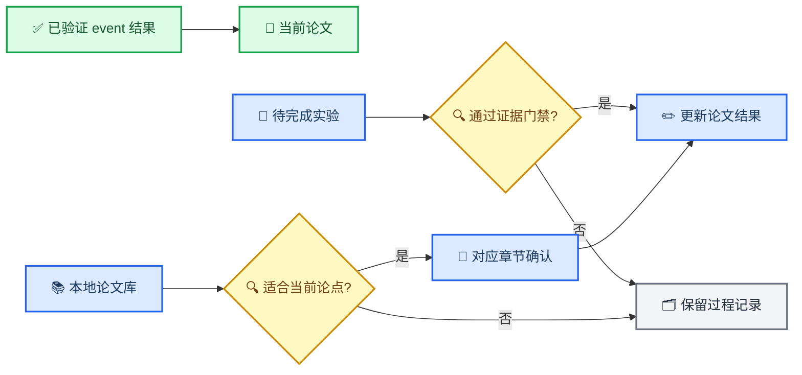

# FDN EI 论文进度与实验清单

_当前论文、实验待办与本地文献审计，更新于 2026-08-24_

---

## 📋 TL;DR

- **论文状态：** Evaluation、Conclusion 与对照方法引用已同步到 Overleaf，当前提交为 `01b8a58`
- **当前证据：** 论文使用 v3 无泄露 event 表中的 14 种方法，FDN 在三个地区均优于单分支 GWN
- **实验边界：** 未完成的容量对照、多种子、收敛、效率和外部基准只记录在本文，不提前写入论文
- **文献状态：** 本地 11 份 PDF 已完成初筛，6 份建议加入 Related Work，1 份可选，3 份已引用，1 份不建议纳入
- **远端状态：** full-window 42 项目前为 14 项完成、3 项失败、3 项中断、22 项未启动，不能写成正在运行或完整结果
- **训练授权：** 新训练、租用 GPU、恢复远端队列仍需用户明确授权

---

## 🎯 论文与证据更新流程

---

## ✅ 当前论文快照

| 项目 | 当前内容 | 证据或入口 |
| --- | --- | --- |
| Overleaf 提交 | `01b8a58` | `Expand evaluation and cite comparison methods` |
| Evaluation | v3 无泄露 event 协议、14 种方法、Average MAE 主表 | [Evaluation](../../overleaf_paper/Sections/4-Evaluation.tex) |
| Conclusion | FDN 方法总结与三地区一致优于 GWN 的结论 | [Conclusion](../../overleaf_paper/Sections/5-Conclusion.tex) |
| 参考文献 | 18 条，新增 AGCRN、ASTGCN、STTN、DSTAGNN、DGCRN、BiST | [report.bib](../../overleaf_paper/report.bib) |
| 结果主表 | seed 42、最多 30 epoch、14 种方法的论文子集 | [verified table](../../outputs/protocol_v3_noleak_dedup/event_full45_fdn_20260812/verified_table/table.csv) |
| FDN Average MAE | Alameda 12.129261、Contra Costa 13.282892、Orange 12.562904 | verified table |
| GWN Average MAE | Alameda 12.616974、Contra Costa 13.462997、Orange 12.916876 | verified table |
| 相对改善 | 3.87%、1.34%、2.74% | 由 verified table 计算 |

论文正文只维护已完成、已复验和已经确认的内容。下面的实验计划不进入当前稿件。

---

## 🔍 远端训练只读审计

审计时间为 2026-08-24 10:42，远端以无卡模式启动。数据盘完整保留，当前没有训练、runner 或 CUDA 进程。检查对象为 `protocol_v3_noleak_dedup` 下的 full-window 42 项矩阵。

| 状态 | 数量 | 说明 |
| --- | ---: | --- |
| 正式完成 | 14 | 任务目录、`summary.json` 和 completed state 已落盘 |
| 失败 | 3 | Alameda BiST、Alameda NDR-Net、Contra Costa BiST，均因 run identity model mismatch 失败 |
| 中断 | 3 | Alameda DGCRN、Contra Costa ASTGCN、Contra Costa DSTAGNN，state 仍写 running，但当前没有对应进程 |
| 未启动 | 22 | 主要为 Contra Costa 后续任务和全部 Orange 任务 |
| 合计 | 42 | 尚未形成完整矩阵、postflight、composite 或论文表 |

共享 `queue_status.json` 只反映最后写入的单个 7 项 shard，并显示 3/7。六个 shard 并发共用同一个状态文件，因此该文件不能作为 42 项总体进度。总体状态必须从 42 项 manifest、逐任务 state 和正式任务目录联合重建。

三个中断任务的检查点只包含模型权重、best epoch 和验证指标，不包含 optimizer、scheduler、下一 epoch 游标或随机数状态。它们不能严格续跑，若恢复正式矩阵，需要保留现有 staging incident 并从 epoch 0 新建 attempt。

已落盘的 Alameda full-window FDN 与 GWN Average MAE 分别为 `10.816044` 和 `11.249785`。该方向支持 FDN，但当前只是一组已完成单项，完整矩阵与发布门禁完成前不进入论文。

FDN benchmark v1 的代码和 manifest 已存在于远端，但没有对应结果目录或正式任务，因此其状态仍为训练前门禁完成、正式训练未启动。

---

## 🧪 实验清单

### 最高优先级

| 实验 | 当前状态 | 最小设计 | 完成门 | 完成后的论文动作 |
| --- | --- | --- | --- | --- |
| FDN benchmark v1 | 训练前门禁完成，正式训练未启动 | PEMS04、PEMS08；GWN、DualGWN、fixed-K3、learnable-K3；seeds 42、1、2；100 epoch | 24 项完成，runner 和报告验收通过，满足预注册 Go 或 No-Go | 决定是否将外部基准作为论文主实验 |
| 等容量 DualGWN 对照 | 已纳入 FDN benchmark v1 | DualGWN 与 FDN 使用相同双分支容量 | 两个数据集方向一致，至少 5 个种子配对点支持 FDN | 将“完整模型优于 GWN”升级为更明确的机制证据 |
| fixed-K3 与 learnable-K3 消融 | 已纳入 FDN benchmark v1 | 每个数据集和种子均配对 | 固定与可学习 mask 的结果完整落盘 | 增加 decomposition ablation 表 |
| 多种子稳定性 | v3 event 主表目前只有 seed 42 | 至少补 seeds 1、2，并保持相同 split 和指标 | 三种子均值、样本标准差和方向一致性完成 | 将单次结果升级为多种子报告 |

正式 FDN benchmark 的设计、停止线和数据身份见 [启动审计](../audits/fdn_benchmark_v1_launch_2026-08-22.md)。

### 第二优先级

| 实验或分析 | 当前状态 | 需要产物 | 写入论文的条件 |
| --- | --- | --- | --- |
| 收敛审计 | 广义 v3 审计最后可验证为 1/39 | FDN 与关键对照的完整训练曲线、best epoch、scheduler 记录 | 正式矩阵完成并复验 |
| 效率对比 | 尚未形成论文表 | 参数量、训练时间、单样本推理时间、峰值显存 | 相同硬件和批量口径 |
| 学习后频率 mask | seed 42 的 mask 已落盘 | 各地区和多种子的 7-bin mask 汇总 | 结果身份与对应任务绑定 |
| XTraffic 等容量消融 | 尚未注册正式 manifest | GWN、DualGWN、fixed-K3、learnable-K3 的同机配对 | 先固定协议、停止线和任务身份 |
| full-window 对比 | 本地没有可验收的完整发布产物 | source-host postflight、逐文件回传、composite 和结果表 | 全部门禁通过后再更新状态 |

### 条件性扩展

| 扩展 | 启动条件 | 目的 |
| --- | --- | --- |
| PEMS03 与 PEMS07 | PEMS04、PEMS08 通过 Go 门 | 扩大外部数据集覆盖 |
| 更长预测窗口 | 基础 benchmark 结论稳定 | 检查频率路由在不同 horizon 下的表现 |
| 组件效率与可视化 | 多种子结果完成 | 形成 mask、性能和资源消耗的联合解释 |

---

## 📚 本地论文库审计

### 建议状态

| 本地论文 | 与 FDN 的关系 | 建议 | 推荐位置 |
| --- | --- | --- | --- |
| [FEDformer](../../论文/FEDformer.pdf) | 傅里叶频率选择与分解式 Transformer | **建议引用** | Related Work 的 frequency-aware forecasting[^1] |
| [MSD-Mixer](../../论文/MSD.pdf) | 多尺度分解与分解残差完整性 | **建议引用** | Related Work 的 decomposition methods[^2] |
| [XTraffic](../../论文/2407.11477v1.pdf) | 本论文数据集 | 已引用 | Introduction、Evaluation |
| [ST-TIS](../../论文/TKDE23_STTIS.pdf) | 轻量交通 Transformer 与效率设计 | 可选引用 | Spatiotemporal forecasting 背景[^3] |
| [DLinear](<../../论文/02124-AAAI23.ZengA(1).pdf>) | 分解加简单线性模型，强调复杂结构并非唯一增益来源 | **建议引用** | Related Work 的 simple forecasting baselines[^4] |
| [IGSTGNN](../../论文/IGSTGNN.pdf) | 事故引导交通预测的直接对照 | 已引用 | Introduction、Related Work、Evaluation |
| [Balance and Brighten](<../../论文/Balance and Brighten- A Twin-Propeller Network to Release Potential of Physics Laws for Traffic State Estimation.pdf>) | 物理约束交通状态估计和知识蒸馏 | 不建议纳入 | 任务与 FDN 主线距离较远 |
| [STAEformer](../../论文/2308.10425v5.pdf) | 强交通 Transformer 和表示学习基线 | **建议引用** | Related Work 的 traffic Transformer[^5] |
| [Autoformer](../../论文/NeurIPS-2021-autoformer-decomposition-transformers-with-auto-correlation-for-long-term-series-forecasting-Paper.pdf) | 渐进式时序分解和周期依赖 | **建议引用** | Related Work 的 decomposition forecasting[^6] |
| [Graph WaveNet](../../论文/GWN.pdf) | FDN 的直接骨干 | 已引用 | Introduction、Methodology、Evaluation |
| [STL](../../论文/STL.pdf) | 经典季节、趋势和余项分解 | **建议引用** | Related Work 的分解基础[^7] |

### 推荐加入 Related Work 的文献

| 建议 citation key | 题目 | 元数据 |
| --- | --- | --- |
| `zhou2022fedformer` | FEDformer: Frequency Enhanced Decomposed Transformer for Long-term Series Forecasting | ICML 2022，PMLR 162，27268--27286[^1] |
| `zhong2024msdmixer` | A Multi-Scale Decomposition MLP-Mixer for Time Series Analysis | PVLDB 17(7)，1723--1736，DOI `10.14778/3654621.3654637`[^2] |
| `zeng2023dlinear` | Are Transformers Effective for Time Series Forecasting? | AAAI 37(9)，11121--11128，DOI `10.1609/aaai.v37i9.26317`[^4] |
| `liu2023staeformer` | STAEformer: Spatio-Temporal Adaptive Embedding Makes Vanilla Transformer SOTA for Traffic Forecasting | CIKM 2023，4125--4129，DOI `10.1145/3583780.3615160`[^5] |
| `wu2021autoformer` | Autoformer: Decomposition Transformers with Auto-Correlation for Long-Term Series Forecasting | NeurIPS 34，22419--22430[^6] |
| `cleveland1990stl` | STL: A Seasonal-Trend Decomposition Procedure Based on Loess | Journal of Official Statistics 6(1)，3--73[^7] |
| `li2023sttis` | A Lightweight and Accurate Spatial-Temporal Transformer for Traffic Forecasting | IEEE TKDE 35(11)，10967--10980，DOI `10.1109/TKDE.2022.3233086`[^3] |

这些文献应由 Related Work 的章节负责人确认论述位置后再加入正文。仅把 BibTeX 条目放进 `report.bib` 而不在正文引用，不会出现在最终参考文献列表中。

---

## 📍 同步规则

1. 所有尚未完成的实验只更新本文，不提前进入论文正文
2. 新结果必须先通过 runner、source-host postflight、逐文件哈希和 composite 门禁
3. 论文数字只从正式表或不可变 prediction artifact 生成
4. 修改 Related Work 前先由对应章节负责人确认
5. 新引用必须核对原始论文、正式元数据和 BibTeX 编译
6. 每次 Overleaf 推送后在本文记录提交 SHA 和修改范围
7. 训练、租卡、重启队列和恢复远端任务仍需用户明确授权

---

## 🔗 References

[^1]: Zhou, T., Ma, Z., Wen, Q., Wang, X., Sun, L., and Jin, R. (2022). "FEDformer: Frequency Enhanced Decomposed Transformer for Long-term Series Forecasting." _Proceedings of the 39th International Conference on Machine Learning_. https://proceedings.mlr.press/v162/zhou22g.html

[^2]: Zhong, S., Song, S., Zhuo, W., Li, G., Liu, Y., and Chan, S.-H. G. (2024). "A Multi-Scale Decomposition MLP-Mixer for Time Series Analysis." _Proceedings of the VLDB Endowment_. https://doi.org/10.14778/3654621.3654637

[^3]: Li, G., Zhong, S., Deng, X., Xiang, L., Chan, S.-H. G., Li, R., Liu, Y., Zhang, M., Hung, C.-C., and Peng, W.-C. (2023). "A Lightweight and Accurate Spatial-Temporal Transformer for Traffic Forecasting." _IEEE Transactions on Knowledge and Data Engineering_. https://doi.org/10.1109/TKDE.2022.3233086

[^4]: Zeng, A., Chen, M., Zhang, L., and Xu, Q. (2023). "Are Transformers Effective for Time Series Forecasting?" _Proceedings of the AAAI Conference on Artificial Intelligence_. https://doi.org/10.1609/aaai.v37i9.26317

[^5]: Liu, H., Dong, Z., Jiang, R., Deng, J., Deng, J., Chen, Q., and Song, X. (2023). "STAEformer: Spatio-Temporal Adaptive Embedding Makes Vanilla Transformer SOTA for Traffic Forecasting." _Proceedings of the 32nd ACM International Conference on Information and Knowledge Management_. https://doi.org/10.1145/3583780.3615160

[^6]: Wu, H., Xu, J., Wang, J., and Long, M. (2021). "Autoformer: Decomposition Transformers with Auto-Correlation for Long-Term Series Forecasting." _Advances in Neural Information Processing Systems_. https://proceedings.neurips.cc/paper_files/paper/2021/hash/bcc0d400288793e8bdcd7c19a8ac0c2b-Abstract.html

[^7]: Cleveland, R. B., Cleveland, W. S., McRae, J. E., and Terpenning, I. (1990). "STL: A Seasonal-Trend Decomposition Procedure Based on Loess." _Journal of Official Statistics_. https://www.scb.se/contentassets/ca21efb41fee47d293bbee5bf7be7fb3/stl-a-seasonal-trend-decomposition-procedure-based-on-loess.pdf
